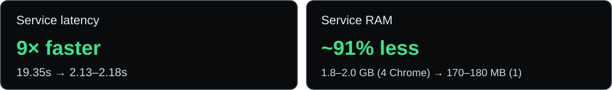

<div align="center">

<h1>⚡ EzSolver</h1>

<p><strong>Fast, cross-platform Cloudflare Turnstile solver powered by a real browser.</strong><br/>
No paid solving APIs. No third-party CAPTCHA-solving services. Just Python and Chrome.</p>

[](https://python.org)
[]()
[]()
[](https://github.com/ismoiloffS)

</div>

<p align="center">
  
</p>

<p align="center"><sub>Author-reported October 2026 benchmarks. RAM figures compare different browser concurrency configurations; see the methodology notes below.</sub></p>

---

## How it works

EzSolver uses Python, [nodriver](https://github.com/ultrafunkamsterdam/nodriver), and a real Chrome session to interact with Cloudflare Turnstile widgets. It does not require a paid CAPTCHA-solving API.

- **Persistent service browser:** `service.py` starts one Chrome instance at service startup and reuses its tab across requests, avoiding repeated browser cold starts.
- **Standalone CLI:** `solver.py` starts a fresh Chrome instance for each run; it is simpler to use but does not reuse the browser between runs.
- **Less page overhead:** Stops pending page loads (`window.stop()`), clears unnecessary DOM, and renders a widget for testing.
- **Widget and error handling:** Reads Turnstile callbacks, handles managed/checkbox widget interaction, and reports callback error codes promptly when supplied.
- **Lower resource use:** Reduced Xvfb resolution on Linux, Chrome startup flags, and a persistent browser help limit overhead. The V8 flag controls a JavaScript heap limit, **not** total Chrome process memory.
- **Windows and Linux:** Auto-detects Chrome and a profile directory; on Linux without `DISPLAY` it starts Xvfb automatically.

**Scope:** Intended for development and integration testing on pages you own or are authorized to test. Getting a browser token is not a guarantee that a site's server will accept it; server-side validation and challenge behavior vary.

## Requirements

- Python **3.8+**
- Google Chrome installed
- `nodriver` Python package
- **Linux only:** `Xvfb` (for headless servers)

---

## Installation

**1. Clone the repo**

```bash
git clone https://github.com/ismoiloffS/EzSolver.git
cd EzSolver
```

**2. Install the Python dependency**

```bash
pip install nodriver
```

**3. Linux headless servers only — install Xvfb**

```bash
sudo apt install xvfb
```

> Windows users: nothing extra needed, Chrome runs normally.

---

## Usage

### Option A — Standalone solver (single token)

Run `solver.py` directly from the command line:

```bash
python solver.py <sitekey> <siteurl>
```

**Example:**

```bash
python solver.py 0x4AAAAAAABS7TtLxsNa7Z2e https://peet.ws/turnstile-test/managed.html
```

Or using Cloudflare's official dummy test key:

```bash
python solver.py 3x00000000000000000000FF https://example.com/
```

**Output:**

```
[solver] clicking Cloudflare iframe at (48, 52)
1.abc123...longtoken...xyz
```

---

### Option B — Local API service

Start `service.py` once and send as many solve requests as you want via HTTP.

**Start the service:**

```bash
python service.py
```

```
[service] Turnstile solver service running on http://0.0.0.0:8191
```

**Send a request with the CLI client:**

```bash
python clientsend.py <sitekey> <siteurl> [timeout]
```

```bash
python clientsend.py 0x4AAAAAAABS7TtLxsNa7Z2e https://peet.ws/turnstile-test/managed.html
```

```
Token (2.18s): 1.abc123...longtoken...xyz
```

**Or call it from your own code / any HTTP client:**

```bash
curl -s -X POST http://127.0.0.1:8191/solve \
  -H "Content-Type: application/json" \
  -d '{"sitekey":"0x4AAAAAAABS7TtLxsNa7Z2e","siteurl":"https://peet.ws/turnstile-test/managed.html"}'
```

```json
{
  "token": "1.abc123...longtoken...xyz",
  "elapsed": 2.18
}
```

**Use it from Python:**

```python
from clientsend import request_token

token, elapsed = request_token(
    sitekey="0x4AAAAAAABS7TtLxsNa7Z2e",
    siteurl="https://peet.ws/turnstile-test/managed.html"
)
print(f"Got token in {elapsed}s: {token}")
```

---

## API reference

### `POST /solve`

| Field | Type | Required | Default | Description |
|-------|------|----------|---------|-------------|
| `sitekey` | string | yes | — | Turnstile sitekey from the target page |
| `siteurl` | string | yes | — | Full URL of the page with the Turnstile widget |
| `timeout` | integer | no | `45` | Max seconds to wait for a token |

**Success response `200`:**
```json
{ "token": "0.abc...", "elapsed": 12.5 }
```

**Error response `500`:**
```json
{ "error": "Turnstile token not obtained within 45s" }
```

### `GET /health`

Basic process status:

```bash
curl http://127.0.0.1:8191/health
```

Idle response example:

```json
{ "status": "ok", "active": 0, "queued": 0 }
```

- `active` counts in-flight HTTP solve requests, **including requests waiting** for the one browser.
- `queued` exists in the response but **does not currently measure the real waiting backlog**; it is updated before a request waits on the solver lock.
- There is no `workers` field and this endpoint does not currently check the browser's health independently.

---

## Benchmarks & Performance

### October 2026 optimization

| Metric | Before | After | Change |
|:--|:--|:--|:--|
| Service solve time | 19.35 s | **2.13–2.18 s** | **~9× faster** |
| Standalone CLI solve time | ~12–15 s | **~3.0–3.5 s** | **~4× faster** |
| Service RAM | ~1,800–2,000 MB (4 Chrome instances) | **~170–180 MB (1 persistent Chrome)** | **~91% less total RAM** |
| RAM per Chrome worker | ~450–500 MB | **~180 MB** | **~2.5–2.8× less** |
| Estimated / observed throughput | ~3–4 tokens/min | **~25–28 tokens/min** | **~7–8× higher** |
| Callback-detected failure | Up to 45 s timeout | **~1.5 s** | **~30× faster failure reporting** |

### Architecture and actual concurrency

| Setting | Current behavior |
|:--|:--|
| Chrome instances per `service.py` process | **1 persistent browser** |
| Solves executing simultaneously | **1** (protected by `PersistentSolver._lock`) |
| HTTP request handling | Threaded; multiple requests can be accepted, but solves wait for the shared browser |
| `MAX_WORKERS` | **Not implemented / ignored** by the current service |
| Timeout | **45 seconds by default** per solve (`timeout` can be sent in the JSON request) |
| Error fast-fail | ~1.5 s in the author's test **when the Turnstile error callback fires**; other failures may still reach timeout |
| Warm start | Chrome initializes when the service starts; later requests reuse it |
| Standalone CLI | One new Chrome for each execution |

**Tokens per minute:** At ~2.15 seconds per successful serial service request, the simple upper-bound calculation is `60 / 2.15 ≈ 27.9` tokens/minute before real-world overhead. The reported **~25–28 tokens/minute** is a best-case, single-service figure. With concurrent callers, requests **wait their turn**; this is not 25–28 tokens per minute *per incoming HTTP thread*.

### What changed

- Reused a **single persistent Chrome instance** instead of launching Chrome for each service request.
- Stopped costly page loads and cleared unnecessary DOM before rendering the widget.
- Added callback-based error reporting and improved iframe detection.
- Reduced Xvfb framebuffer resolution to `1024x768x16` and adjusted Chrome cache and JS heap flags.

### Service security

**`service.py` listens on `0.0.0.0` and has no authentication or rate limiting.** Keep it on a trusted development network, restrict access with firewall rules, or place it behind an authenticated reverse proxy. Do not expose the port directly to the public internet.

---

## Configuration

These are the **actual supported environment variables** in the current code:

| Environment variable | Default | Description |
|:--|:--|:--|
| `CHROME_PATH` | Auto-detected | Path to the Chrome / Chromium executable |
| `TS_PROFILE_DIR` | `%TEMP%\ts_profile` (Windows) or `/tmp/ts_profile` (Linux) | Reusable Chrome profile directory |
| `PORT` | `8191` | HTTP listen port used by `service.py` |

Example:

```bash
PORT=9000 python service.py
```

**Note:** `clientsend.py` currently uses a fixed `SERVICE_URL = "http://127.0.0.1:8191/solve"`. If you change `PORT`, update the client URL or send HTTP requests directly to the new port.

---

## Project structure

```text
EzSolver/
├── assets/
│   └── benchmark.svg   # Performance comparison graphic
├── solver.py            # Browser automation and standalone CLI
├── service.py           # HTTP API and persistent Chrome instance
├── clientsend.py        # Local API client / Python helper
├── LICENSE
└── README.md
```

---

## Troubleshooting

**Chrome not found**
> Set `CHROME_PATH` to the full path of your Chrome executable.

**Timeout / token not received**
> The target site may be serving a harder challenge. Try increasing the timeout: `python clientsend.py <key> <url> 90`

**Linux: Xvfb not found**
> `sudo apt install xvfb`

---

<div align="center">

Made with ☕ by [Ismoiloff](https://github.com/ismoiloffS)

</div>
